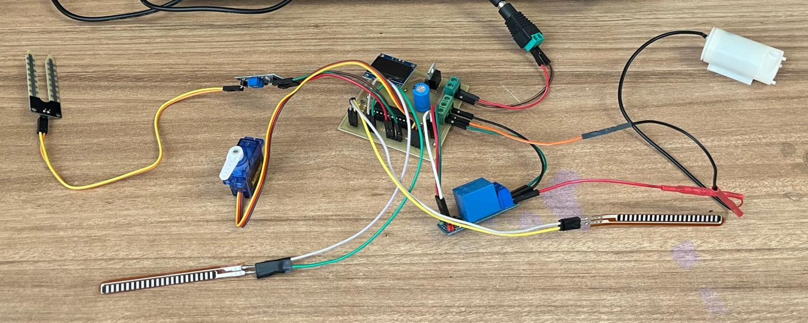
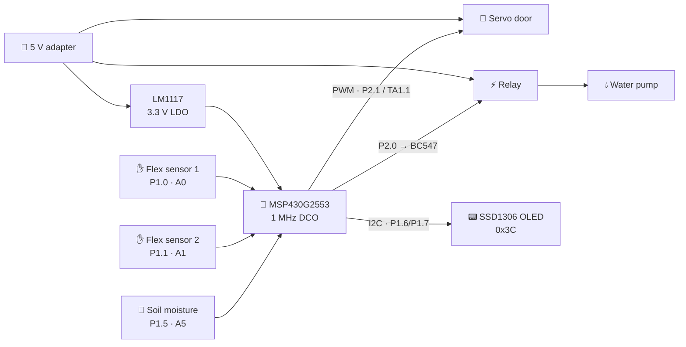
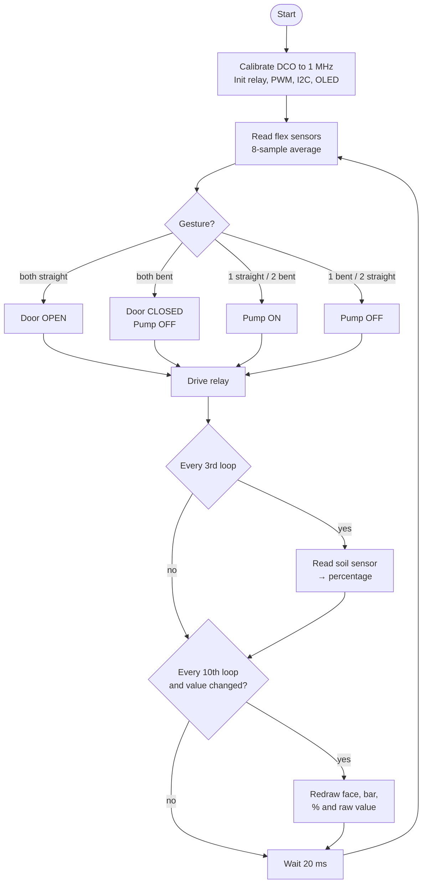
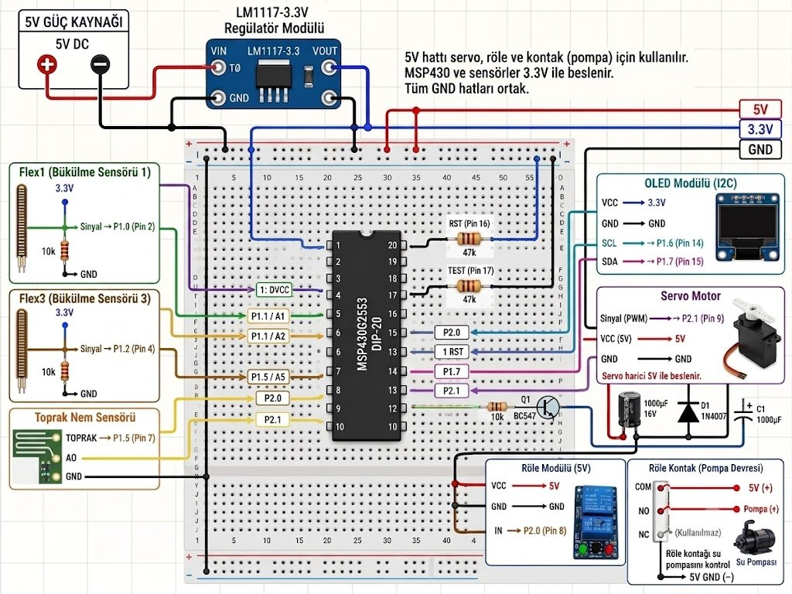
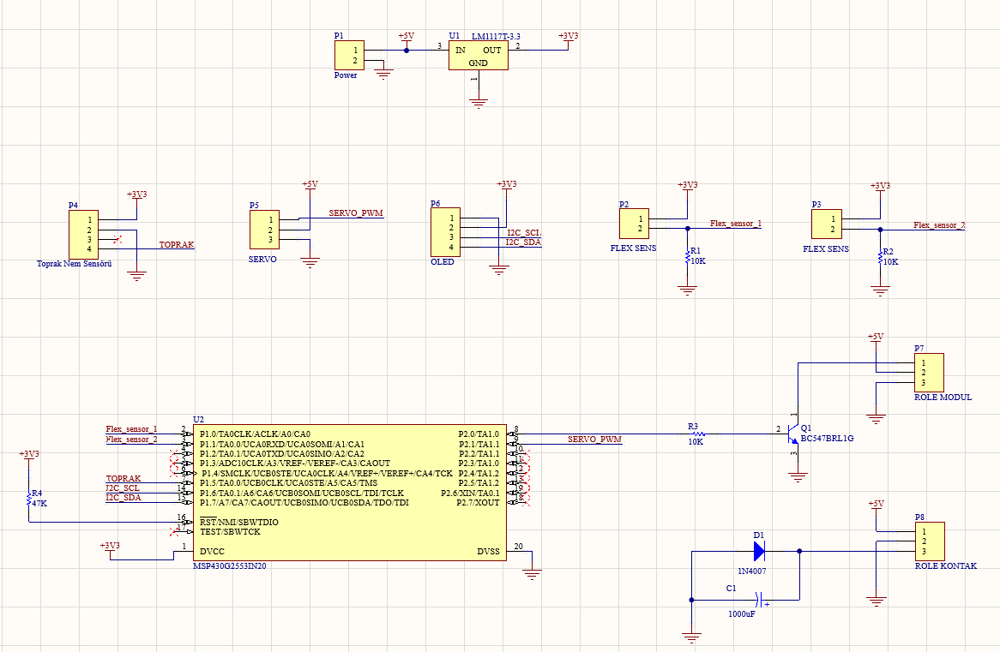
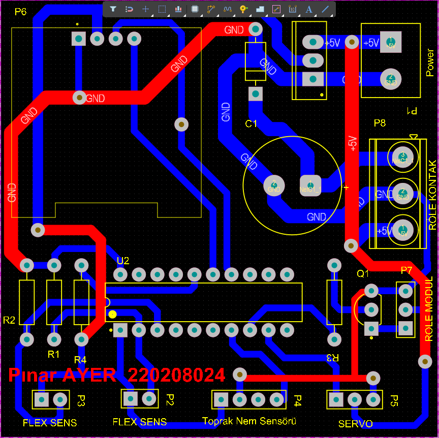
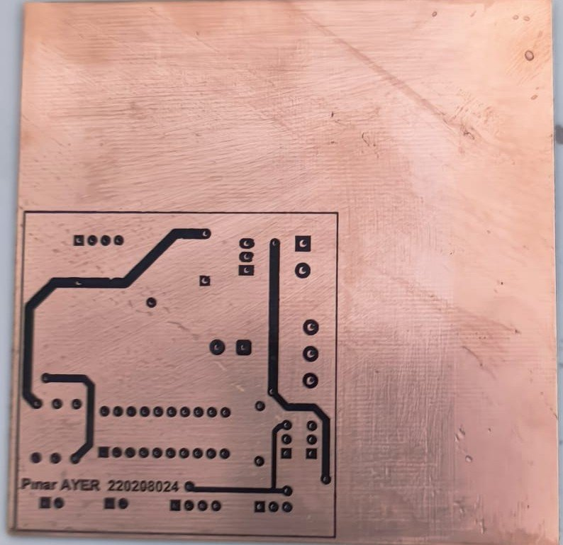
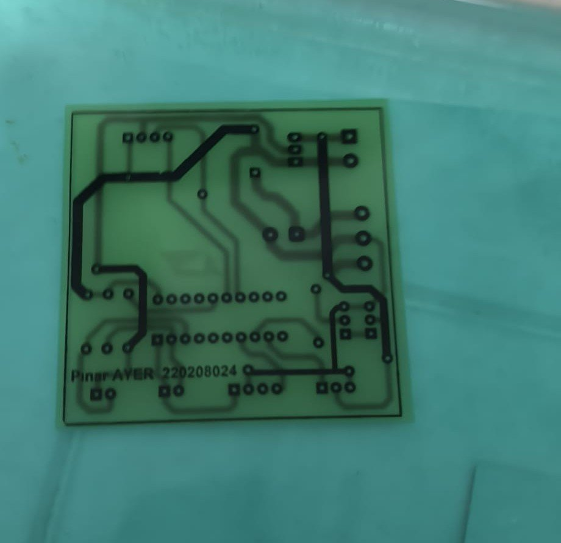
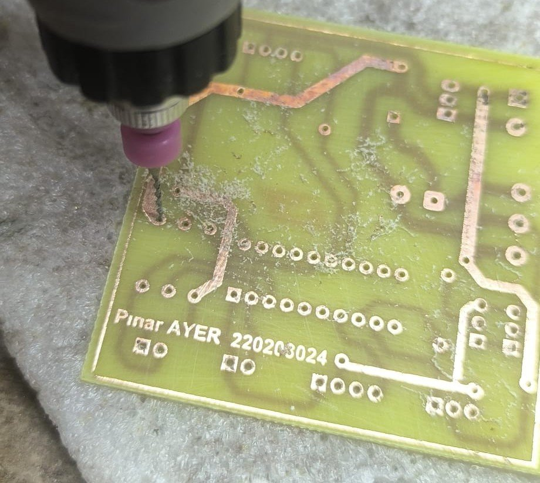
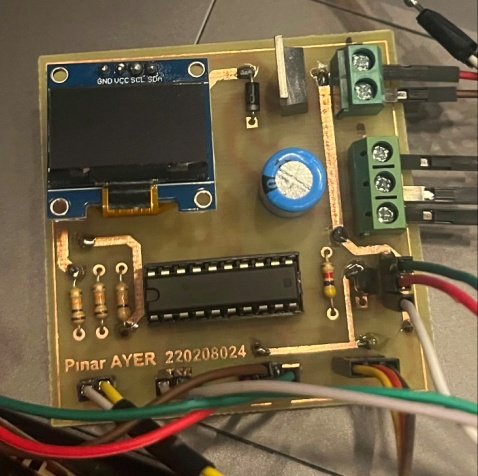

<div align="center">

# ✋🌱 User-Controlled Door, Plant Watering, and Soil Moisture Visualization on LCD via MSP430G2553 and Flex Sensor-Based Hand Gesture Recognition

**Control a door and a water pump with hand gestures, and watch the soil moisture on a custom OLED interface. Written in bare-metal C on an MSP430 with no libraries, on a hand-made PCB.**


<br/><br/>



<sub><i>The complete system: two flex sensors, soil moisture probe, servo "door", water pump, relay and the custom MSP430 board.</i></sub>

</div>

---

## 📌 Overview

This project is a **gesture-controlled smart watering system** built around a **TI MSP430G2553**. Two **flex sensors** worn on the fingers read the user's hand gestures. Depending on the gesture, a **servo motor** opens or closes a door and a **relay** switches a **water pump** on or off. At the same time, a **soil moisture sensor** is measured continuously and shown on a **0.96" SSD1306 OLED** with a percentage, a bar graph and a face that changes with the moisture level.

What makes this project special:

- 🔧 **Fully register-level C**: there is no Arduino, no HAL and no display library. ADC10, Timer_A PWM, USCI_B0 I2C and the SSD1306 driver are all written from scratch.
- 🎨 **Custom graphics**: a hand-made 5-column digit font and 32×32 bitmap faces drawn directly into the OLED's memory.
- 🛠️ **Hand-made PCB**: designed in **Altium Designer**, then made by toner transfer, etching, drilling and soldering.

📄 **Full project report (Turkish):** [PDF](docs/Gesture_Irrigation_Report.pdf) · [DOCX](docs/Gesture_Irrigation_Report.docx)

---

## ✋ Gesture Control

| Flex 1 | Flex 2 | Action |
|:---:|:---:|---|
| ✋ straight | ✋ straight | 🚪 **Door OPEN** (servo → 1.8 ms pulse) |
| ✊ bent | ✊ bent | 🚪 **Door CLOSED** + 💧 **pump OFF** (servo → 1.0 ms pulse) |
| ✋ straight | ✊ bent | 💧 **Pump ON** |
| ✊ bent | ✋ straight | 💧 **Pump OFF** |

> A finger counts as *bent* when its averaged ADC value crosses a calibrated threshold (`FLEX1_ESIK = 250`, `FLEX2_ESIK = 240`). The pump state is **latched**: it stays on until a "pump off" or "close" gesture is made.

---

## 📟 OLED Interface

The screen is updated only when the measured value changes, which avoids flicker and saves I2C bandwidth.

```
┌──────────────────────────┐
│          ( •‿• )         │  ← face: dry 😟 <30% · normal 🙂 <70% · wet 😄 ≥70%
│                          │
│  ▕██████████░░░░░░░░░▏   │  ← 100-pixel moisture bar
│           64 %           │  ← moisture percentage
│           0493           │  ← raw ADC value (for calibration)
└──────────────────────────┘
```

The moisture percentage is calculated from two calibration points measured **on the final PCB** (`DRY = 741`, `WET = 356`):

```c
percent = ((long)DRY_VALUE - raw) * 100 / (DRY_VALUE - WET_VALUE);   // then clamped to 0–100
```

---

## 🧩 System Architecture



### Main loop



---

## 🔌 Pin Map

| MSP430 Pin | Peripheral | Connected to |
|:---:|---|---|
| `P1.0` (A0) | ADC10 | Flex sensor 1 (10 kΩ voltage divider) |
| `P1.1` (A1) | ADC10 | Flex sensor 2 (10 kΩ voltage divider) |
| `P1.5` (A5) | ADC10 | Soil moisture sensor (analog out) |
| `P1.6` / `P1.7` | USCI_B0 I2C SCL / SDA (100 kHz) | SSD1306 OLED |
| `P2.1` | Timer1_A3 · TA1.1 PWM, 50 Hz | Servo motor signal |
| `P2.0` | GPIO (active-low) | Relay driver (BC547) → water pump |

<div align="center">

<br/><sub><i>Wiring diagram: 5 V rail for servo, relay and pump; 3.3 V rail from the LM1117 for the MSP430 and the sensors; common GND.</i></sub>
</div>

---

## 🛠️ Hardware Design

### Schematic and PCB layout (Altium Designer)

<table>
<tr>
<td width="55%" align="center"><br/><sub><b>Schematic</b></sub></td>
<td width="45%" align="center"><br/><sub><b>PCB layout</b></sub></td>
</tr>
</table>

**Design decisions:**
- **LM1117-3.3** LDO: 3.3 V for the MSP430, the OLED and the sensors from a single 5 V adapter
- **BC547 transistor** relay driver, because an MSP430 GPIO cannot supply the relay coil current
- **1N4007 flyback diode** across the pump, against inductive voltage spikes when the pump turns off
- **1000 µF bulk capacitors** to absorb the current peaks of the servo and the pump
- **47 kΩ pull-ups** on `RST` and `TEST` for stand-alone operation of the DIP-20 MSP430
- **Screw terminals and headers** for every external part, so that sensors and motors can be swapped easily

### 🏭 Hand-made PCB: from layout to board

<table>
<tr>
<td width="25%" align="center"><br/><sub><b>1. Toner transfer</b></sub></td>
<td width="25%" align="center"><br/><sub><b>2. Etching</b></sub></td>
<td width="25%" align="center"><br/><sub><b>3. Drilling</b></sub></td>
<td width="25%" align="center"><br/><sub><b>4. Soldered and assembled</b></sub></td>
</tr>
</table>

---

## 💻 Code Highlights

**Servo PWM with Timer1_A: 50 Hz, pulse width in µs (1 MHz clock)**
```c
TA1CCR0  = 20000 - 1;            // 20 ms period → 50 Hz
TA1CCTL1 = OUTMOD_7;             // reset/set PWM mode
TA1CCR1  = KAPI_KAPALI;          // 1000 µs = door closed (1800 µs = open)
TA1CTL   = TASSEL_2 | MC_1 | TACLR;   // SMCLK, up mode
```

**Noise-resistant ADC reading: one dummy read, then an average of 8 samples**
```c
unsigned int adc_ortalama_oku(unsigned int kanal, unsigned int bit) {
    unsigned long toplam = 0;
    adc_tek_oku(kanal, bit);                 // discard first sample
    for (i = 0; i < 8; i++) {
        toplam += adc_tek_oku(kanal, bit);
        __delay_cycles(1000);
    }
    return toplam / 8;
}
```

**Robust I2C: NACK detection and timeouts, so a disconnected OLED never freezes the system**
```c
while (!(IFG2 & UCB0TXIFG)) {
    if (UCB0STAT & UCNACKIFG) { UCB0STAT &= ~UCNACKIFG; return 0; }
    if (--timeout == 0) return 0;
}
```
If the OLED stops responding, `oled_ok` is cleared and all drawing is skipped. Gesture control, the servo and the pump keep working.

---

## 🧯 Problems Solved

| Problem | Solution |
|---|---|
| Servo jittered when the pump started (voltage drop on the shared supply) | Reorganised power distribution and added bulk capacitors |
| Pump turn-off caused inductive voltage spikes | 1N4007 flyback diode across the pump |
| MSP430 GPIO could not drive the relay coil | BC547 transistor driver stage |
| Soil sensor readings changed after moving from breadboard to PCB | Re-calibrated `DRY` / `WET` values on the final board |
| Limited board space for power and pump traces | Re-placed components and kept power traces short and wide |

---

## 📁 Project Structure

```
gesture-irrigation-msp430/
├── firmware/
│   └── main.c                 # complete bare-metal firmware
├── hardware/
│   └── altium/
│       ├── sematik.SchDoc     # schematic
│       ├── PCB1.PcbDoc        # PCB layout
│       └── PCB_Pinar_.PrjPcb  # Altium project file
├── docs/
│   ├── Gesture_Irrigation_Report.pdf
│   └── Gesture_Irrigation_Report.docx
├── images/
└── README.md
```

---

## 🚀 Getting Started

1. Create a new **MSP430G2553** project in **Code Composer Studio** and replace its `main.c` with `firmware/main.c`.
2. Flash the chip with an **MSP-EXP430G2 LaunchPad**, then move it to the custom board (or run it directly on the LaunchPad).
3. **Calibrate** for your own sensors:
   - Read the soil sensor in dry and in wet soil and set `DRY_VALUE` / `WET_VALUE`. The raw value is shown on the bottom line of the OLED.
   - Adjust `FLEX1_ESIK` / `FLEX2_ESIK` to the straight-finger and bent-finger readings of your flex sensors.
   - Fine-tune `KAPI_ACIK` / `KAPI_KAPALI` (in µs) for your servo's end positions.
4. Power the board from a **5 V adapter** that can supply the servo and pump peaks.

---

## 🔭 Future Improvements

- [ ] **Automatic watering mode**: start the pump when moisture drops below a threshold
- [ ] Use the MSP430's **low-power modes** with timer interrupts instead of busy-wait delays
- [ ] Add a third flex sensor for more gestures
- [ ] Add wireless monitoring (e.g. an HC-05 or ESP-01 module) for remote moisture tracking

---

<div align="center">

👩‍💻 Developed by **[Pınar Ayer](https://github.com/Ayer8315)** · Microprocessors Course Project · Electronics and Communication Engineering, Kocaeli University

</div>
